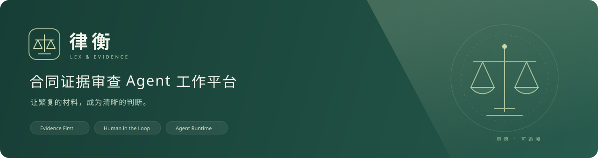
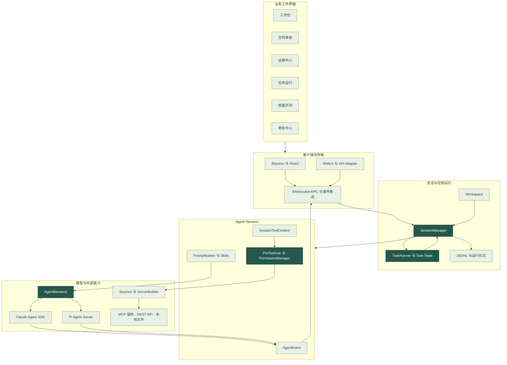
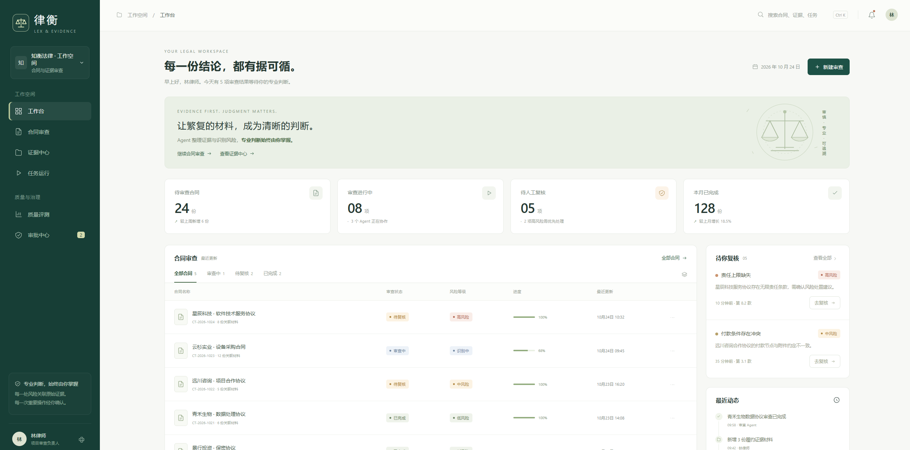
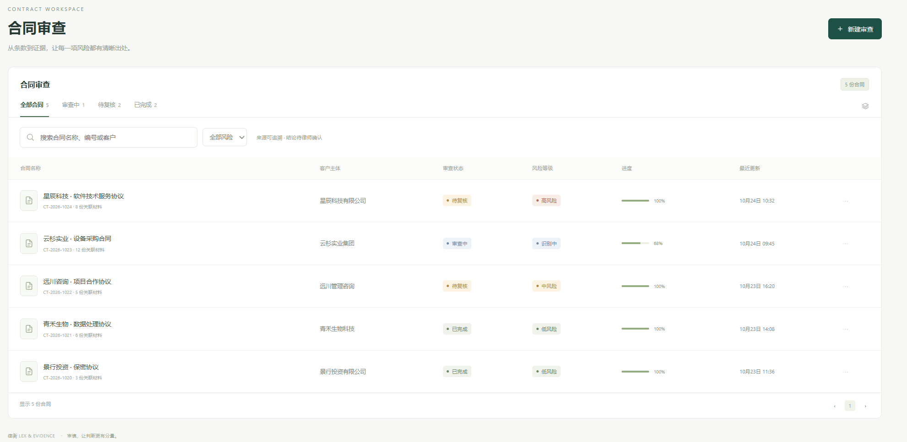
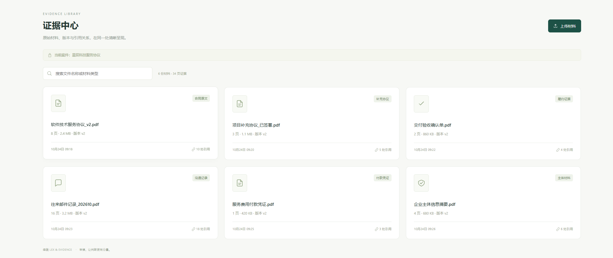
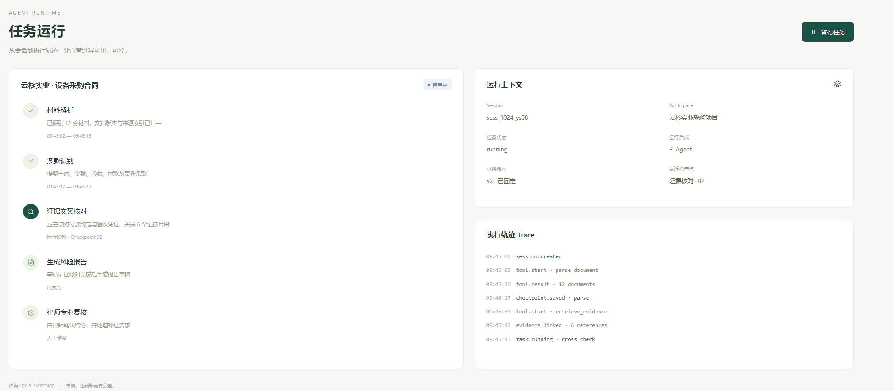
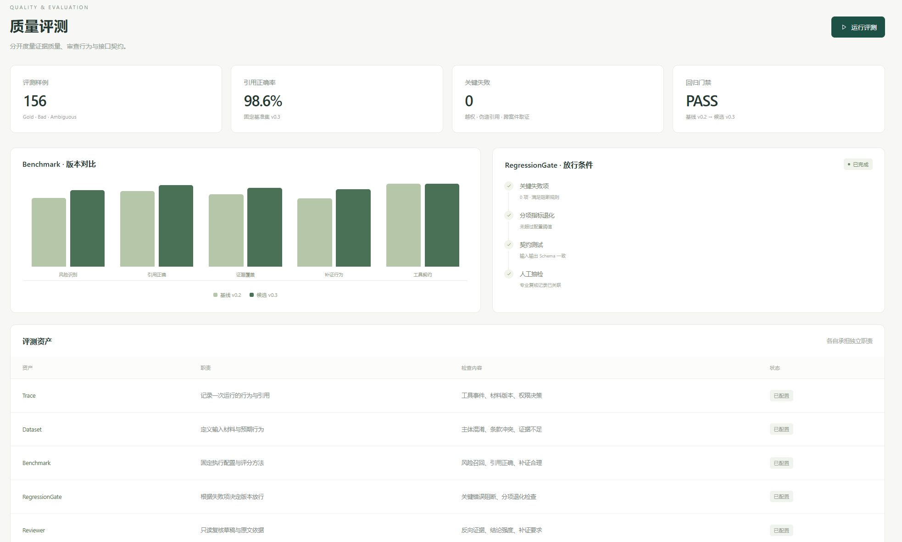
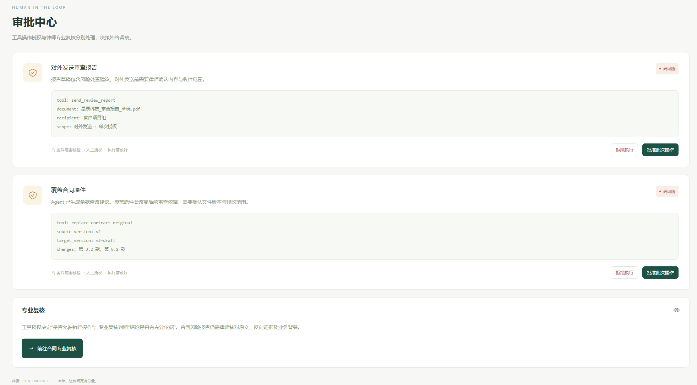

### 每一份结论，都有据可循。

面向律师与企业法务的合同证据审查工作平台


合同审查 · 证据关联 · Tool Calling · Context Engineering · Agent Runtime · 人工复核

[项目概述](#项目概述) · [核心能力](#核心能力) · [核心技术](#核心技术) · [系统架构](#系统架构) · [运行截图](#运行截图) · [项目结构](#项目结构)

---

## 项目概述

**律衡（Lex & Evidence）** 是面向合同与履约证据审查场景的 Agent 工作平台。项目将合同原文、补充协议、验收材料、付款凭证和往来记录组织在同一工作空间，围绕条款风险、证据依据、任务过程与人工确认建立统一的工作视图。

合同审查需要同时回答三个问题：**条款约定了什么、材料能够证明什么、结论是否具有充分依据。** 律衡以此组织合同审查、证据中心、任务运行、质量评测与审批中心，让律师在查看风险的同时核对原文、追踪证据、记录复核意见。

项目以 **Agent Harness 与 Runtime** 承载工具调用、上下文装配、会话管理和执行控制，以 **Human in the Loop** 区分材料整理、工具操作授权与专业复核。Agent 辅助组织审查过程，律师保留最终判断与风险处置决定。

```text
合同与关联材料 → 条款识别 → 证据交叉核对 → 风险报告草稿 → 律师复核
                    │              │               │             │
                 审查议题        原文引用        运行轨迹       复核意见
```

## 核心能力

| 模块 | 核心内容 | 工作价值 |
| :--- | :--- | :--- |
| 🏠 **工作台** | 合同状态、待办复核、风险分布、任务进度与最近动态 | 汇总工作重点，优先关注需要人工判断的事项 |
| 📄 **合同审查** | 合同检索、风险筛选、原文查看、条款定位与复核意见 | 将合同、风险发现与审查依据放在同一视图 |
| 🗂️ **证据中心** | 材料分类、版本信息、关联文件与引用位置 | 从风险结论回到合同原文及履约材料 |
| ⚙️ **任务运行** | 执行阶段、会话上下文、任务状态与 Trace | 查看 Agent 在做什么，以及工具调用与输出过程 |
| 📊 **质量评测** | 评测资产、版本对比、分项指标与门禁规则 | 分别关注证据质量、审查行为和接口一致性 |
| 🛡️ **审批中心** | 高风险操作请求、调用参数、批准拒绝与专业复核入口 | 将工具执行授权与法律专业判断分开处理 |

## 核心技术

### 1. Agent Backend · 统一模型后端

通过 `AgentBackend` 抽象对接 **Claude Agent SDK 与 Pi SDK**，由 `BaseAgent` 承接公共前置处理，并通过事件适配器将不同后端的输出转换为统一的 `AgentEvent`。

- **统一调用边界**：对话、取消、模型配置和能力查询通过公共接口组织。
- **统一事件语义**：文本增量、工具启动、工具结果、错误及完成事件使用一致的上层表达。
- **后端适配分离**：供应商 SDK 差异由各自适配层处理，会话与界面消费统一事件。

关键代码：[后端接口](packages/shared/src/agent/backend/types.ts) · [BaseAgent](packages/shared/src/agent/base-agent.ts) · [事件适配](packages/shared/src/agent/backend/base-event-adapter.ts)

### 2. MCP Hub · 工具接入与会话上下文

通过 Sources 管理 MCP、REST API 和本地材料入口，由 `SourceServerBuilder` 构造连接配置；凭据管理模块提供认证信息，`SessionToolContext` 为工具处理器注入会话标识、工作目录与回调能力。

```text
Source 配置 → 凭据解析 → MCP 或 API 工具构造 → 会话工具注册 → 调用结果回传
```

工具接入与工具实现分层，使材料访问能力、外部服务连接和 Agent 执行流程能够分别维护。

关键代码：[SourceServerBuilder](packages/shared/src/sources/server-builder.ts) · [SessionToolContext](packages/session-tools-core/src/context.ts)

### 3. Context Engineering · 上下文装配与技能加载

`PromptBuilder` 将稳定上下文与动态上下文分开处理：工作空间能力等稳定信息与会话状态、激活来源等动态信息分别装配，减少高频变化内容对稳定提示词前缀的影响。

Skills 提供任务指令与流程知识，Sources 提供外部事实和操作能力。审查规则、案件材料与工具返回分别承担不同职责，避免将全部内容混合在一个不断增长的提示词中。

关键代码：[PromptBuilder](packages/shared/src/agent/core/prompt-builder.ts) · [上下文分区测试](packages/shared/src/agent/__tests__/prompt-builder-context-split.test.ts) · [Skills](packages/shared/src/skills)

### 4. Agent Runtime · 会话、工作空间与任务状态

Runtime 由 `SessionManager`、Workspace、`TaskRunner`、运行后端和持久化模块共同组成。

| 对象 | 管理职责 |
| :--- | :--- |
| **SessionManager** | 会话创建与加载、消息执行、Agent 关联、事件分发和取消控制 |
| **Workspace** | 工作目录、Sources、Skills、配置与会话的组织边界 |
| **TaskRunner** | 解析任务依赖，调度就绪节点，创建子会话并汇总节点输出 |
| **Task State** | 区分 `running`、`paused`、`verifying`、`stopped`、`completed` 与 `failed` |
| **Session Storage** | 使用 JSONL 保存会话头与消息，以持久化队列组织写入 |
| **Pi Agent Server** | 使用进程外 JSONL 通信承载 Pi 后端执行 |

`TaskRunner` 以 `task.yaml` 描述节点关系，通过 `depends_on` 与输入引用连接子任务，结合并发限制、会话完成回调和追加式运行日志组织执行过程。任务状态与会话状态分别建模，便于同时观察整体任务和具体执行单元。

关键代码：[SessionManager](packages/server-core/src/sessions/SessionManager.ts) · [TaskRunner](packages/server-core/src/tasks/TaskRunner.ts) · [任务 Schema](packages/shared/src/tasks/schema.ts) · [会话存储](packages/shared/src/sessions/jsonl.ts)

### 5. Agent Harness · 执行前权限管线

工具执行边界由 **Permission Mode、PreToolUse 与权限管理模块**共同约束。`PreToolUse` 在执行前检查权限模式、来源激活状态、前置条件和输入参数，再由调用层处理放行、拒绝或人工授权。

```text
工具调用请求
    ↓
权限模式检查 → 来源与前置条件检查 → 输入校验
    ↓
直接放行 / 阻断 / 发起人工授权
    ↓
执行结果与权限事件回传
```

合同原件覆盖和报告外发在业务界面中归入高风险操作。审批界面展示目标文件、修改范围与收件范围；专业复核关注结论与证据之间的关系，两类判断分别处理。

凭据使用 **AES-256-GCM** 加密文件存储；本地 MCP 子进程通过环境变量过滤减少不相关凭据的暴露。

关键代码：[PreToolUse](packages/shared/src/agent/core/pre-tool-use.ts) · [PermissionManager](packages/shared/src/agent/core/permission-manager.ts) · [凭据模块](packages/shared/src/credentials)

### 6. Agent Eval · 分层质量体系

质量评测按六类资产组织，分别描述执行记录、测试案例、评分方法、回归规则、专业复核与接口行为。

| 资产 | 核心职责 | 关注内容 |
| :--- | :--- | :--- |
| **Trace** | 记录一次运行的执行过程 | 工具输入输出、证据引用、错误与权限决策 |
| **Dataset** | 定义评测输入与预期行为 | 正常、错误及歧义案例；条款冲突、主体混淆、证据不足 |
| **Benchmark** | 固定版本对比与评分方法 | 风险识别、引用正确性、证据覆盖和补证行为 |
| **RegressionGate** | 定义版本放行条件 | 关键失败项、指标退化、契约检查和人工抽检 |
| **Reviewer** | 复核草稿与原文依据 | 反向证据、引用支撑程度、结论强度和补证要求 |
| **Contract Tests** | 检查接口与事件协议 | 工具参数、返回结构、错误码与事件关联 |

工程验证使用 TypeScript 类型检查、Bun Test、事件适配测试、权限测试和服务冒烟测试。质量页面分别呈现业务评测与工程契约，避免将接口通过率与审查结论质量混为同一个指标。

关键代码：[事件适配测试](packages/shared/src/agent/__tests__/base-event-adapter.test.ts) · [权限管线测试](packages/shared/src/agent/core/__tests__/pre-tool-use-checks.isolated.ts) · [后端冒烟测试](packages/server/src/__tests__/smoke.test.ts)

### 7. 前端与工程栈

沿用项目的 TypeScript、React 与 Electron 体系，通过 Web API Adapter 复用桌面端界面，使用 WebSocket RPC 连接服务层。合同审查界面采用深墨绿导航与暖白工作区，以表格、证据卡片、双栏原文审查和任务时间线组织信息。

| 层次 | 技术选型 | 主要用途 |
| :--- | :--- | :--- |
| 语言与工作区 | **TypeScript · Bun Workspaces** | 类型约束、包管理与多包职责拆分 |
| Agent 后端 | **Claude Agent SDK · Pi SDK** | 模型交互、工具执行与后端适配 |
| 工具协议 | **MCP · REST API · Zod** | 外部能力接入与输入输出契约 |
| 客户端 | **Electron · React 18 · WebUI** | 桌面交互与浏览器访问 |
| 界面与状态 | **Tailwind CSS v4 · shadcn/ui · Jotai** | 组件、样式和会话界面状态 |
| 通信 | **WebSocket RPC · AgentEvent · JSONL** | 请求响应、流式事件与进程通信 |
| 持久化与凭据 | **JSONL · 配置文件 · AES-256-GCM** | 会话、工作空间及敏感凭据管理 |
| 构建与验证 | **Vite · esbuild · Bun Test · tsc** | 前端构建、主进程打包与工程检查 |

## 系统架构

### 分层架构



### 关键架构取舍

- **工具接入与执行治理分离**：Source 管理连接方式和凭据，Harness 管理调用前检查，工具处理器承担具体操作。
- **Session 与 Task 分离**：Session 保存会话上下文，Task 表达节点依赖和执行状态，子会话作为任务节点的执行单元。
- **执行权限与专业复核分离**：权限管线回答“能否执行”，律师复核回答“结论是否具有充分依据”。
- **事件协议与供应商适配分离**：具体 SDK 事件在后端适配层转换，上层统一消费 AgentEvent。
- **业务评测与契约验证分离**：前者关注证据与结论，后者检查参数、结果和事件结构。

## 运行截图

### 🏠 工作台

集中查看合同状态、待复核风险、Agent 任务进度和最近动态。



### 📄 合同审查

按名称、编号和客户检索合同，结合审查状态与风险等级筛选工作事项。



### 🗂️ 证据中心

按案件组织合同、补充协议、履约证据与主体材料，呈现版本和引用信息。



### ⚙️ 任务运行

通过执行时间线、Session、Workspace、任务状态与 Trace 查看运行过程。



### 📊 质量评测

集中呈现 Benchmark 版本对比、RegressionGate 放行条件和六类评测资产。



### 🛡️ 审批中心

展示报告外发、原件覆盖等高风险操作的参数范围、授权请求与专业复核入口。



## 项目结构

```text
.
├── apps/
│   ├── electron/              # 桌面应用、React 页面与预加载桥
│   ├── webui/                 # 浏览器入口与 Web API Adapter
│   ├── viewer/                # 会话分享查看器
│   └── cli/                   # 命令行客户端
├── packages/
│   ├── core/                  # 核心类型与公共协议
│   ├── shared/                # Agent、Sources、Skills、Workspace 与存储
│   ├── server-core/           # SessionManager、TaskRunner、RPC 与权限服务
│   ├── server/                # 独立服务入口
│   ├── session-tools-core/    # 会话工具定义与上下文
│   ├── session-mcp-server/    # 会话工具 MCP 服务
│   ├── pi-agent-server/       # Pi 进程外执行服务
│   ├── messaging-gateway/     # 消息接入与规范化
│   └── ui/                    # 共享界面组件
├── docs/                      # 文档与品牌资源
└── scripts/                   # 构建与工程检查脚本
```

## 🤝 致谢与许可证

Agent 底座采用 [Craft Agents](https://github.com/lukilabs/craft-agents-oss) 的工程体系，结合合同与证据审查场景组织业务页面与工作流程。文档的视觉编排参考 [Poirot](https://github.com/HezaoHezao/poirot)，感谢相关开源项目的贡献。

项目遵循 [Apache License 2.0](LICENSE)，保留上游版权与第三方声明，详见 [NOTICE](NOTICE)。Claude Agent SDK 的使用同时受 Anthropic 对应条款约束。

---

**律衡 · Lex & Evidence**

证据有出处，判断有分量。
